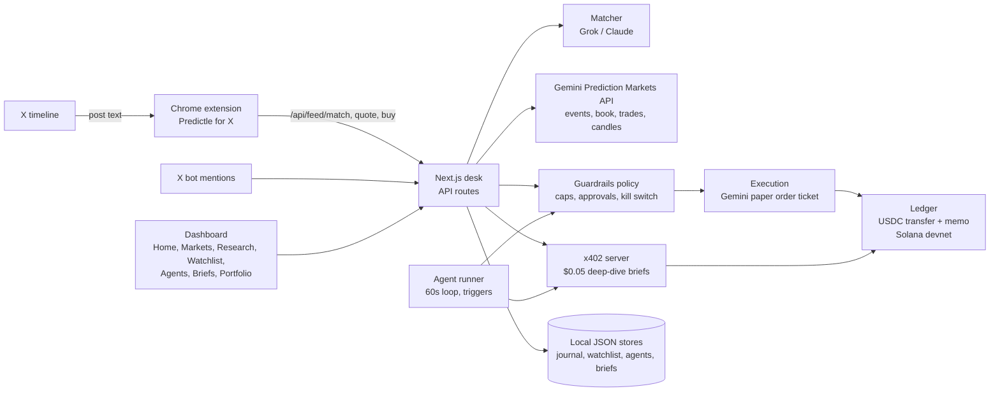

# Predictle — News-to-Trade Desk

Turn a news post on X into a safe, researched prediction-market bet in seconds, paid in USDC on Solana with hard spending limits.

Built for the **UBC 2026 Hackathon** (University Blockchain Conference, UT Austin).

| | |
|---|---|
| **Main track** | Agentic Payments & AI |
| **Chain award** | Best use of Solana (devnet) |
| **Bounties** | Gemini Prediction Markets, Grok Bot |
| **Demo video** | _add link_ |

## The problem

News breaks on X and prediction-market odds move within seconds. Acting on it means leaving the timeline, finding the right market, working out what the price means, checking how it resolves, and placing the order. That's too slow for anyone, and beginners often misread prices, fees and settlement rules. When an AI agent trades instead, a new problem appears: how do you let it spend money without letting it run away with your wallet?

## What it does

- **Market card under X posts.** A Chrome extension reads the post you're looking at, matches it to a live Gemini prediction market (with Grok, or Claude as a fallback), and shows the question, live YES/NO prices and a 24-hour chart right under the post.
- **Research page, Beginner and Pro.** Beginners get the question in plain English, exactly how it resolves, what they pay and win, a liquidity check and the real price history. Pros get the order book ladder, recent trades, the strike ladder, indicators and an order ticket. Only real Gemini data is shown; panels without a real data source are hidden.
- **Why it moved.** X posts are pulled in when they line up with an odds move, from the extension and from X recent search.
- **Guarded buys paid on Solana.** Each buy is a Gemini order ticket (paper mode) plus a real USDC transfer on Solana devnet with a memo, and every receipt links to Solana Explorer. Policy guardrails apply: small buys auto-approve, larger ones need approval, and there's a per-trade cap, a daily cap, a market allowlist, a sender allowlist and a kill switch.
- **Pay-per-answer research over x402.** A deep-dive brief costs $0.05, paid in devnet USDC through the HTTP 402 payment flow. Briefs are kept in a searchable library that flags them when the odds have moved since they were written.
- **Watchlist agents.** Star any market and assign an agent with a personality, triggers (odds moves, volume spikes, X mention surges, level crosses, ending soon) and a budget. Each agent can:
  - watch and notify you,
  - suggest bets for your approval, or
  - bet on its own within both its own budget and the global policy.

  Agents can also buy briefs.
- **Portfolio.** Profit and loss, open positions marked at the live Gemini bid, spend vs the daily cap, P/L by category, a calibration chart and an activity log with receipts. All of it exports to CSV.
- **X bot.** A mention bot that understands `yes $5`, `approve` and `status`, sending every bet through the same guardrails.

## Architecture



How a buy flows:
1. The extension, dashboard, X bot or an agent proposes a trade intent.
2. The guardrails check the market, sender, per-trade cap, daily cap and kill switch, then auto-approve or queue it for approval.
3. Execution builds the Gemini order ticket (paper mode) and the ledger sends the matching USDC transfer on Solana devnet with a memo tying the two together.
4. The journal records the fill and the signature, and the portfolio and receipts read from it.

### Code layout

One folder per feature, with lint-enforced import boundaries. UI code never imports server code.

| Path | What it does |
|---|---|
| `extension/` | Chrome MV3 extension: post extraction, market card, popup, options |
| `src/app/` | Next.js App Router pages and `api/` routes |
| `src/features/markets` | Gemini client: schemas (zod), TTL caches, concurrency cap, 429 retry, request dedupe |
| `src/features/catalog` | Market browsing, the Home rail and the watchlist |
| `src/features/matcher`, `grok`, `claude`, `llm` | Post-to-market matching and LLM provider selection |
| `src/features/research`, `market-pro`, `history` | Beginner and Pro research views, indicators, price history |
| `src/features/guardrails` | Spending policy |
| `src/features/execution`, `ledger`, `journal` | Order tickets, Solana USDC transfers, the trade journal |
| `src/features/x402`, `desk` | x402 payment server, deep-dive briefs, brief library, desk runtime |
| `src/features/agents` | Agent store, triggers, budgets, permissions, decisions, runner |
| `src/features/positions` | Portfolio math, calibration, CSV export |
| `src/features/xbot`, `xfeed`, `chatter` | X mention bot, X recent search, post chatter per market |
| `src/shared` | Types shared across the layers |

## Tech stack

- Next.js 16, React 19, TypeScript (strict), zod
- `@solana/web3.js`, `@solana/spl-token` with Circle devnet USDC and the Memo program
- x402 (HTTP 402 Payment Required), implemented directly for Solana devnet
- Gemini Prediction Markets REST API
- xAI Grok API (Claude optional) for matching, briefs and agent messages
- X API v2 (recent search, mentions)
- Chrome Extension Manifest V3, built with esbuild
- Vitest and happy-dom, ESLint with feature-boundary rules

## Run it locally

Requires Node 20+ and Chrome.

```bash
git clone https://github.com/ScriptKitKat/UBC-Hacakthon.git
cd UBC-Hacakthon
npm ci
cp .env.example .env.local   # then fill in the values below
npm run setup:devnet         # devnet keypair + USDC setup helper
npm run dev                  # http://localhost:3000
```

Load the extension:

```bash
npm run extension:build
```

Then open `chrome://extensions`, turn on Developer mode, choose **Load unpacked** and select `extension/dist`. Browse x.com and market cards appear under matching posts.

### Environment

See `.env.example` for the full list.

| Group | Variables |
|---|---|
| Gemini | `GEMINI_API_BASE`, `GEMINI_API_KEY`, `GEMINI_API_SECRET`, `TRADING_MODE` (`paper`) |
| Solana | `SOLANA_CLUSTER`, `SOLANA_RPC_URL`, `SOLANA_KEYPAIR_PATH`, `USDC_MINT`, `VAULT_RECIPIENT` |
| Guardrails | `DAILY_CAP_USD`, `AUTO_APPROVE_MAX_USD`, `PER_TRADE_MAX_USD`, `MARKET_ALLOWLIST`, `SENDER_ALLOWLIST`, `MARKET_CATEGORIES` |
| AI | `XAI_API_KEY`, `XAI_MODEL`, optional `ANTHROPIC_API_KEY`, `ANTHROPIC_MODEL` |
| X | `X_BEARER_TOKEN` (search); `X_API_KEY`, `X_API_SECRET`, `X_ACCESS_TOKEN`, `X_ACCESS_SECRET`, `X_BOT_USER_ID`, `X_BOT_HANDLE`, `XBOT_WEBHOOK_TOKEN` (bot) |
| Extension feed | `FEED_OPERATOR_ID`, `FEED_EXTENSION_ORIGINS`, `FEED_API_TOKEN`, `FEED_PREWARM_TOKEN` |

Without an AI key, matching, briefs and agent messages fall back to rule-based logic, and the UI labels it as such. Without X keys, posts come only from the extension.

### Checks

```bash
npm run check             # typecheck + lint + unit tests
npm run build
npm run extension:build
npm run test:integration  # Solana ledger against a live cluster
```

## Safety

- Trading runs in **paper mode** on Gemini, and payments use **Solana devnet** USDC. The ledger refuses to run against an unexpected network.
- Every spend, whether from a human, the extension, the X bot or an agent, goes through the same policy, which fails closed.
- Agents can never exceed their own budget or the global caps, and suggestions always require approval.
- Write routes check the Origin and Sec-Fetch-Site headers. No keys or keypairs are committed.


## Grok Bot's role

Grok Bot (this project's dedicated "UBC hackathon bot") was the build and ops agent for Predictle throughout the hackathon: spinning up parallel agents for pages, reviewing and merging PRs, researching what beginners and pros need on market research screens, drafting the pitch video script, and writing this README. Inside the product, the xAI Grok API matches X posts to Gemini markets, polishes research briefs, and powers watchlist-agent decisions and messages. A cleaned export of the build chat is in [`docs/grok-bot-chat-export.md`](docs/grok-bot-chat-export.md).

## Sponsor tools

- **Gemini Prediction Markets:** market discovery, order books, trades, candles and the order-ticket format.
- **Solana:** devnet USDC transfers with memos for every bet and brief, with Explorer receipts.
- **x402:** pay-per-request research briefs.
- **Grok Bot / xAI Grok:** Grok Bot built and operated the project during the hackathon; the Grok API matches posts to markets, polishes briefs, and powers agent decisions. See [Grok Bot's role](#grok-bots-role) and the [chat export](docs/grok-bot-chat-export.md).

## What's next

- Live Gemini order routing behind the same guardrails, plus limit orders and sell to close
- Stream prices over Gemini WebSockets instead of polling
- Agent wallets with per-agent onchain spending limits
- Real fees in the ticket from Gemini's published fee schedule
- A hosted desk so the extension works without running a local server

## Team

Priscilla Ye ([@ScriptKitKat](https://github.com/ScriptKitKat)), UT Austin
